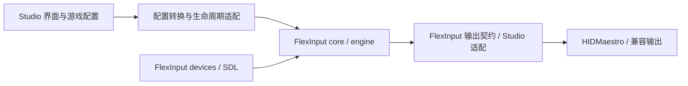

# FlexInput 模块与接入范围

本清单依据已经固定的 FlexInput 0.16.9，提交 `c69f53ad3bca4ed34ef5f2d63509addaa7c767be`。当前状态更新到 Motion Studio 0.8.0；下表区分已经接入的部分与后续可选范围。

产品方向：Studio 提供游戏、动作、配置和手柄操作界面；设备读取、映射、体感算法和输出优先使用 FlexInput。配置转换、进程监督和界面交互由 Studio 负责。

## 源码模块

上游工作区包含 11 个库 crate 和 1 个应用入口。模块清单以固定提交的 [Cargo.toml](https://github.com/x-iso/FlexInput/blob/c69f53ad3bca4ed34ef5f2d63509addaa7c767be/Cargo.toml) 为准。

| 模块 | 职责 | Studio 当前状态 | 建议接入范围 |
|---|---|---|---|
| `core` | 信号、节点与连线、AutoMap 总线、设备帧、IMU、Flick 等基础类型和公共计算 | 已复用所需子集 | 必需，继续以它为基础，不另建同类数据和算法体系 |
| `engine` | 图求值、映射、3DOF/RWS、滤波曲线、动作状态、路由和处理线程 | 已通过 headless 入口复用求值器、体感和纯曲线等；未接入完整上游运行调度 | 必需，继续扩大复用；原有线程入口须适配 Studio 的事件、停止和状态接口 |
| `devices` | 实体设备枚举、识别、按键/轴/触摸/体感读取；gilrs、原生 HID、SDL 等后端；部分实体设备反馈 | 已接入原始 SDL provider 及聚合前的带时间戳事件接口；原生 HID 解析器虽已编译，其轮询 provider 尚未启用 | 当前使用上游全 SDL 选项；专用原生 provider 需要相同的逐样本接口后再启用 |
| `virtual` | 统一输出设备接口，键鼠和虚拟手柄后端，提交、归零和游戏反馈读取；包含 HIDMaestro、enigo/ViGEm 兼容实现及复合 USB 输出 | 已编译原始设备契约、引脚布局、HidMaestroDevice 和原始 ViGEm Xbox／DS4；手柄编码、提交和归零使用原生实现 | 键鼠保留完整键位与可报错队列适配，手柄直接用原始设备；可选 USB／音频后端未启用 |
| `hidmaestro` | 原生 Rust 驱动客户端、共享内存、报告描述/编码、特征响应、设备创建和部署等 | 已直接编译所需客户端、编码、部署等子集，使用 Studio 受限辅助进程 | 必需，沿用当前接入并维护固定版本；不直接启用整套上游辅助服务 |
| `modules` | 内置节点注册、输入输出定义、模块工厂及部分基础处理；包括数学、逻辑、映射、触摸、显示和网络等节点 | 已编译 processing、logic、math、generator 子集，配置转换使用上游输出描述 | 按需扩展，未注册全部节点或引入原界面 |
| `usbip` | 通过 USB/IP 和虚拟主机控制器提供复合 USB 设备；包括 Sony 手柄的 HID、音频/触觉等接口及设备透传 | 未接入 | 暂缓；需要完整 DualSense 音频/触觉或相关透传能力时再接入，普通键鼠/Xbox/DS4 输出不以它为前提 |
| `joycon2` | Joy-Con 2 及相同协议设备的专用通信、配对、报告解析和校准 | 未接入 | 按目标设备决定；不属于普通 SDL 手柄接入的前提 |
| `btle` | 专用 USB 蓝牙适配器上的 HCI、连接和协议栈，服务部分专用蓝牙输入路径 | 未接入 | 按专用设备需求决定；使用系统蓝牙连接的普通手柄不需要因此接管蓝牙适配器 |
| `net` | 跨机器传输 AutoMap 输入总线，并反向传输震动、灯光等反馈 | 未接入 | 当前本机映射目标可暂缓 |
| `ui` | egui 界面、节点画布、参数控件、设备面板、校准和导航等；也持有一部分后台 I/O 调度代码 | 不编译其界面；保留了 I/O 线程源文件作为参考 | 使用 Studio 界面；将需要的非界面调度逻辑抽为无界面 API 后复用 |
| `app` | 原应用入口、窗口/渲染器启动、打包与辅助进程入口 | 未接入 | 使用现有 Tauri 应用入口和引擎监督 |

`modules` 自身不依赖 egui，不等于参数界面库。复杂映射和体感节点的执行逻辑主要位于 `engine`；节点参数控件主要位于 `ui`。同样，部分高频 I/O 调度位于 `ui/app/threads.rs`，不能只看 crate 名称判断逻辑应归哪一层。

## 0.7.0 首批范围

首批围绕 `core + engine + devices + virtual + hidmaestro` 接入通用 SDL 输入、现有映射和输出契约；`modules` 引入配置转换需要的描述和基础处理。Studio 对外继续提供游戏、动作、体感表单和手柄操作，不要求用户编辑节点图。

Studio 原有 SDL 事件读取和 ABI 解析已替换。输出继续复用已迁入的 HIDMaestro 客户端；原版 `virtual` 的全部后端及可选功能并未整体启用。

## 输入接口与保留条件

0.8.0 继续复用原生 HidHide 客户端与设备树查询，添加受保护的映射隐藏生命周期；从原 `activation.rs` 暴露按压／连发状态机，从 `device_cal.rs` 暴露 `StickRebound`，摇杆区域直接使用 `core::area`。通用配置层、录入输出租约、中英文界面和原生提示属于 Studio 配置与生命周期层。具体修改、审查结果及后续候选见 [flexinput-reuse.md](flexinput-reuse.md#080-practical-feature-review)。

1. **原始事件。** 原始 `DeviceBackend::poll()` 保留为上游轮询接口；新增事件 API 在其传感器配对、滤波和平均之前保留每条读数和双时间戳。数值相同的样本继续独立交给引擎；队列溢出报告错误并停止输出。
2. **按键顺序。** 新接口保留按下/释放和轴事件的 FIFO 顺序。事件过滤器仍让 SDL 内部 watcher 处理 joystick 事件，再清理无需消费的队列；不会阻止 SDL 把原始摇杆/按键转换为标准 gamepad 事件。
3. **单一 SDL 来源。** Rust SDL 绑定使用未经修改的官方 SDL 3.4.18 共享 DLL，Apex 6 Pro 固件修复后已移除原换轴补丁；不启用静态/源码构建。MSVC 延迟导入保证先加载绝对路径，模块在进程内固定到退出，跨停止/重连保留有效函数地址；构建检查 PE 导入表。
4. **设备身份。** 保留完整接口路径和来源判定，避免读回虚拟输出。枚举后释放未选中的手柄；运行时只保留所选接口，界面导航关闭传感器。
5. **依赖裁剪。** headless 入口移除了 MIDI、音频、专用蓝牙和 USB/IP 启动依赖。原生 HID 解析和支持代码可编译，但没有因此自动启动其读取器或其他服务。

保留逐样本处理是与 Studio 当前引擎的接口约定。上游的均值路径属于其轮询设计，本清单不据此判断 FlexInput 原有输入有卡顿问题。

## 输出、反馈与交互边界

- 输出统一接口和传输优先复用上游，连续鼠标继续使用已经校正的发送节奏。Studio 负责配置切换时取消旧队列、F12 停止、断线释放及辅助进程监督。
- 游戏反馈横跨 `virtual::poll_outputs()`、`engine` 的反馈路由和 `devices::send()`，不是单独一个 crate。0.11.0 已接入基础震动与灯光回传。自适应扳机、音频转触觉和复合 USB 音频能力仍需额外契约。
- 单个设备的陀螺仪、加速度计、姿态和倾斜处理继续复用；不接入多个实体设备之间的体感融合。
- 继续保留已有 JSM 离线导入、游戏配置、组合键、滚轮/侧键和手柄界面导航；这些交互通过适配层使用底层能力。

## 实施状态与后续

1. 已接入独立编译的输入模块和原始事件 API；合成事件覆盖相同读数不合并、双时间戳、快速按下/释放、摇杆及同一进程内两次会话重建。
2. 已统一 SDL 来源，并用 FlexInput provider 替换 Studio 原输入读取。专用原生 HID provider 的逐样本接口及启用属于后续范围，不能把当前解析器的编译状态当作其运行接入完成。
3. 已使用原始输出契约和引脚布局，通过 Studio 可报错适配器保留原有传输、排序和停止保护。HIDMaestro 传输已复用；兼容模式 SendInput/ViGEm 适配器仍保留。
4. 0.11.0 已接入基础震动／灯光回传与原生触摸板手势；专用手柄、音频触觉和其他扩展模块仍未启用。
5. 0.8.0 已补齐按压方式、连发、摇杆内外圈、防回弹及原生隐藏控制。0.11.0 为反馈补齐同一设备句柄、命令基线与断连释放，为触点补齐 FIFO、手势与接触触发输入。软件路径经合成输入与模拟输出验证，实际反馈和触感仍需真机验收。

自动化只使用模拟后端、禁用实体后端的合成 SDL 事件及纯进程检查。实际手柄、桌面输出和游戏手感由用户验证。

## 核对过的上游入口

- [devices：输入后端接口和初始化](https://github.com/x-iso/FlexInput/blob/c69f53ad3bca4ed34ef5f2d63509addaa7c767be/crates/devices/src/lib.rs)
- [SDL 后端：IMU 聚合和事件收集](https://github.com/x-iso/FlexInput/blob/c69f53ad3bca4ed34ef5f2d63509addaa7c767be/crates/devices/src/sdl_backend.rs)
- [原生 HID：设备读取和 IMU 聚合](https://github.com/x-iso/FlexInput/blob/c69f53ad3bca4ed34ef5f2d63509addaa7c767be/crates/devices/src/gyro.rs)
- [virtual：输出设备、提交和反馈接口](https://github.com/x-iso/FlexInput/blob/c69f53ad3bca4ed34ef5f2d63509addaa7c767be/crates/virtual/src/lib.rs)
- [modules：内置节点目录](https://github.com/x-iso/FlexInput/blob/c69f53ad3bca4ed34ef5f2d63509addaa7c767be/crates/modules/src/lib.rs)
- [UI 后台线程：I/O 轮询与输出调度](https://github.com/x-iso/FlexInput/blob/c69f53ad3bca4ed34ef5f2d63509addaa7c767be/crates/ui/src/app/threads.rs)

已经接入的精确边界和 0.6.1 修正记录见 [flexinput-reuse.md](flexinput-reuse.md)。

## 0.10.0 接入复核

原生预处理统一覆盖摇杆各消费者，RWS 恢复原始文件，虚拟手柄编码直接用原生设备类。实际接入、双后端生命周期、就绪检查及未路由的反馈／触点等边界见 [原生输入与输出核查](native-input-output.md)。

## 0.11.0 反馈与触点

原生虚拟反馈已通过同一个选中 SDL 句柄回传；触点 FIFO 与原生 route_touchpad 已启用，并开放接触触发输入。原生 SDK 新命令序号仅用于生命周期基线，不替代反馈解码。详见 [游戏反馈与原生触摸板](peripheral-feedback-and-touch.md)。
